# Supermarket POS System

A desktop-based Supermarket Point of Sale (POS) system designed to simplify retail operations through sales management, inventory control, purchase management, supplier management, reporting and payment processing.

The system is built to operate locally on a supermarket's network, allowing multiple terminals to interact with a centralized MySQL database.

## Overview

The Supermarket POS is designed to help supermarkets manage daily business operations efficiently. It provides an integrated platform for cashiers, storekeepers and administrators to perform their respective tasks.

The system prioritizes data consistency, inventory accuracy, user access control and offline operation.

## Key Features

### 1. Dashboard

- Overview of supermarket operations.
- Sales performance summaries.
- Transaction statistics.
- Business activity monitoring.

### 2. Sales Management

- Process customer transactions.
- Support cash and M-PESA payments.
- Automatically update product stock after successful sales.
- Generate transaction receipts.
- Maintain sales history.
- Support sale cancellation.

### 3. Product Management

- Register new products.
- Manage product categories.
- Set product prices.
- Manage product barcodes.
- Monitor product availability.
- Configure minimum stock levels.

### 4. Inventory Management

- Monitor current stock levels.
- Track stock movements.
- Record stock adjustments.
- Identify low-stock products.
- Maintain inventory records.

### 5. Purchase Management

- Create purchase orders.
- Manage suppliers.
- Add products and quantities to purchase orders.
- Record goods received.
- Manage supplier payments.
- Track purchase history.
- Support purchase order cancellation.

### 6. Supplier Management

- Register suppliers.
- Maintain supplier contact information.
- Manage supplier records.
- Associate suppliers with purchase operations.

### 7. Reports

- Daily sales reports.
- Weekly sales reports.
- Monthly sales reports.
- Custom date-range reports.
- Transaction summaries.
- Business performance information.

### 8. User Management and Security

The system supports role-based access control.

Available roles:

- **Administrator:** Manages system operations and configurations.
- **Storekeeper:** Handles products, inventory and purchasing operations.
- **Cashier:** Processes customer sales.

Additional security features:

- Password hashing using bcrypt.
- Session-based authentication.
- Protected API endpoints.
- Role-based route authorization.

### 9. M-PESA Integration

- M-PESA STK Push integration.
- Payment request initiation.
- Transaction callback handling.
- M-PESA transaction records.
- Payment status tracking.
- Payment status tracking.

### 10. Backup Management

- Local database backup functionality.
- Backup history management.
- Support for restoring business data.

### system screenshots


The following screenshots demonstrate the major interfaces and functionalities of the Supermarket POS system.

### Dashboard
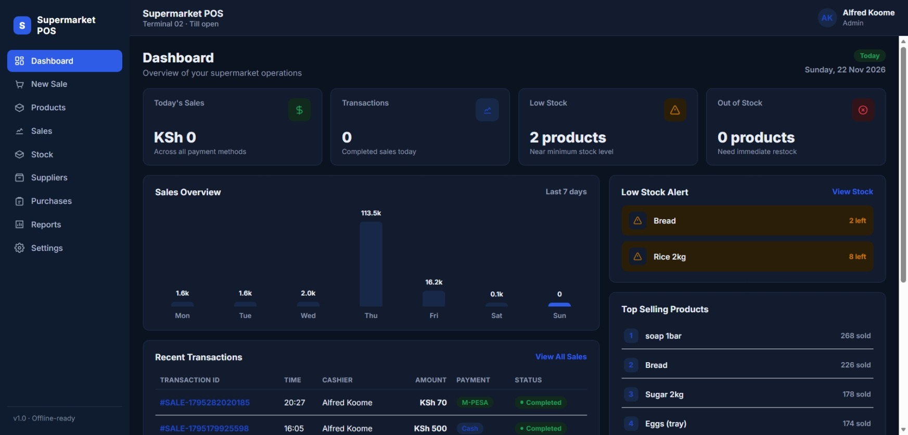

### new sale

### calculator transaction calculation
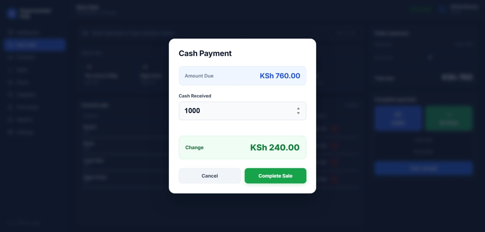

### newsale view
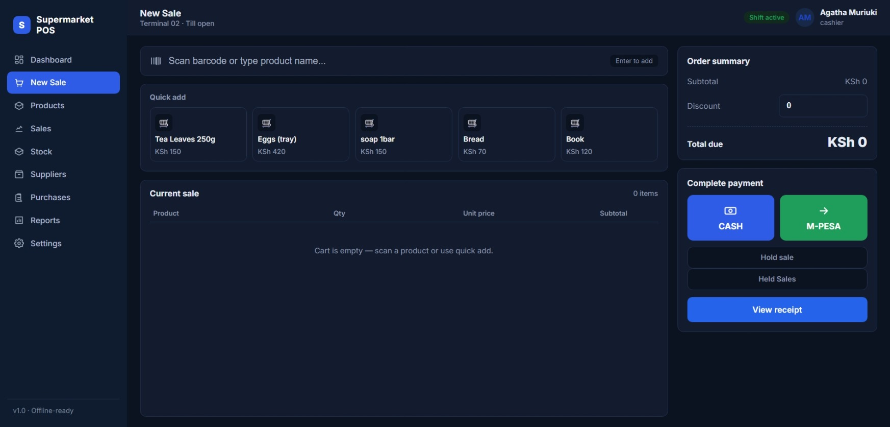,

### receipt
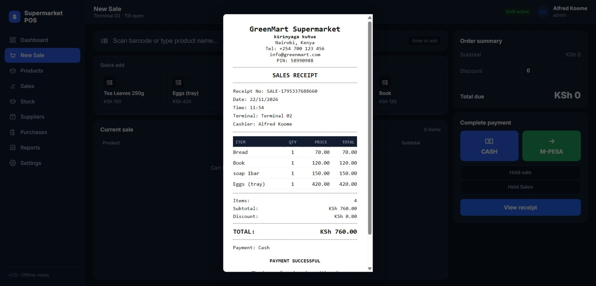

### products


### add product
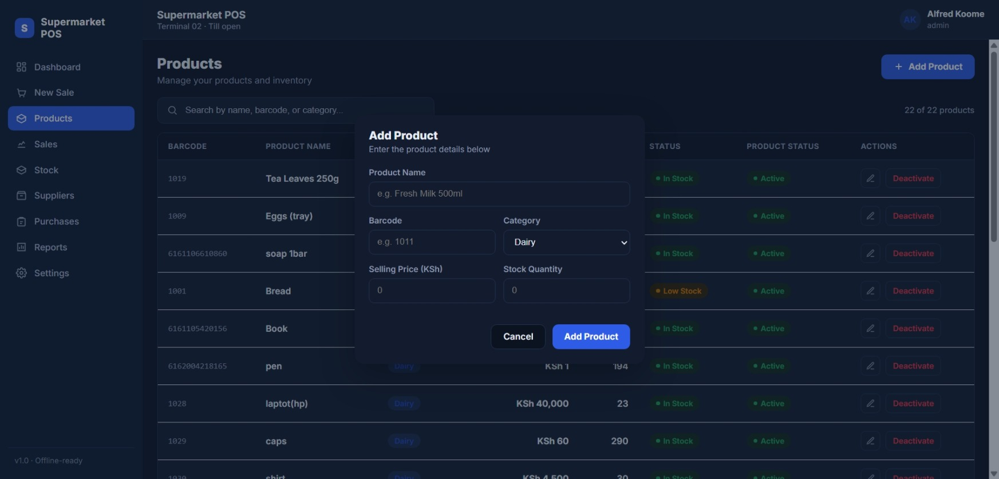

### products screenshot
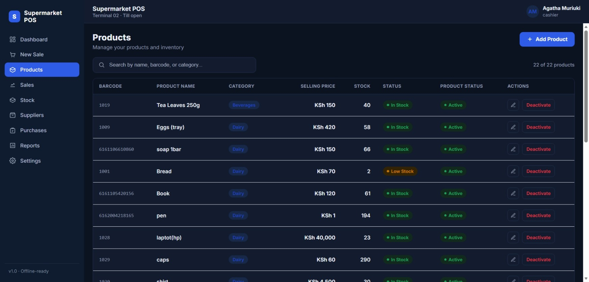

### sales


### purchases

### purchase dashboard
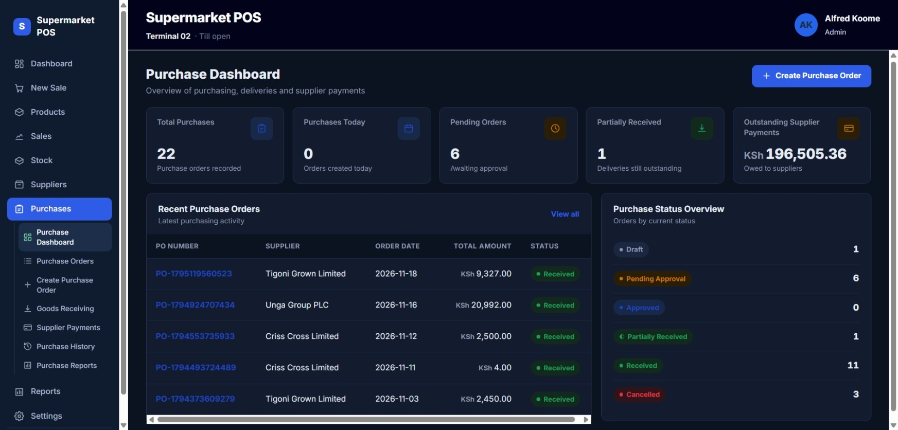

### purchase history
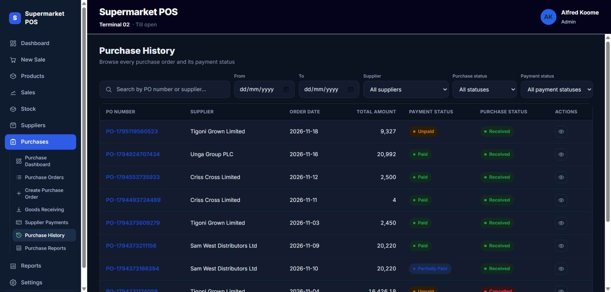

### purchase order
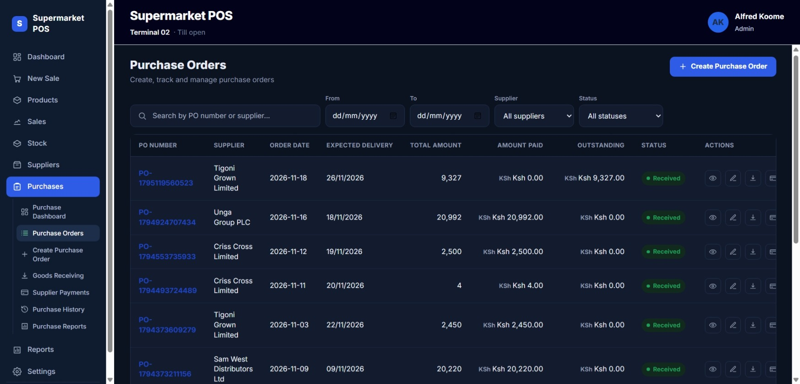

### purchase reports
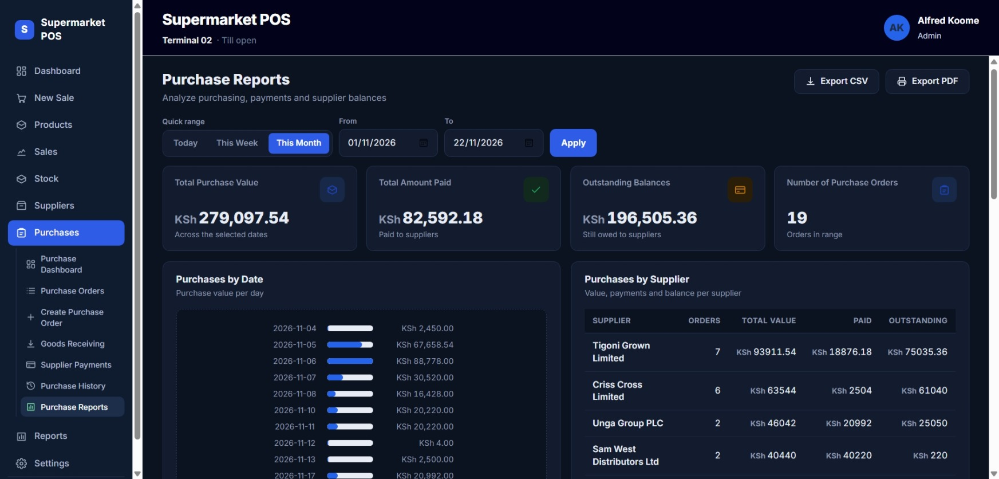

### supplier payment
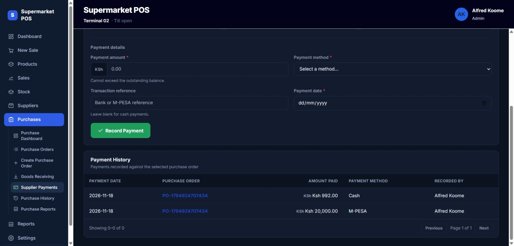

### supplier
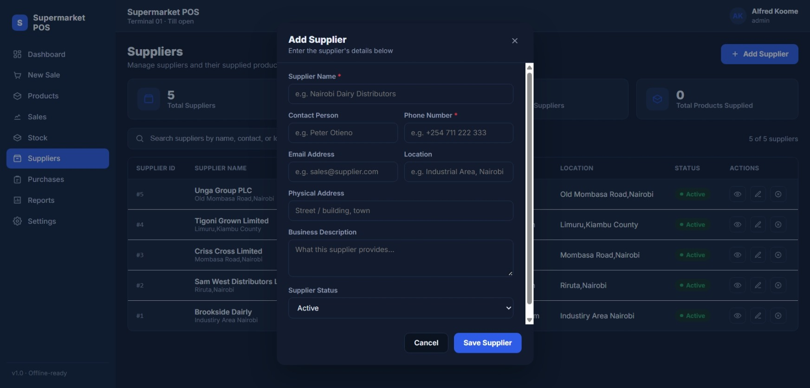

### settings

### employees management
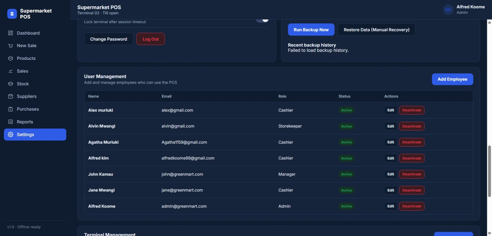

### settings
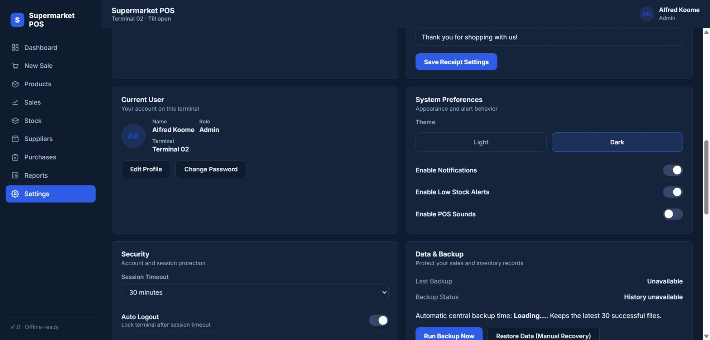

### terminals management
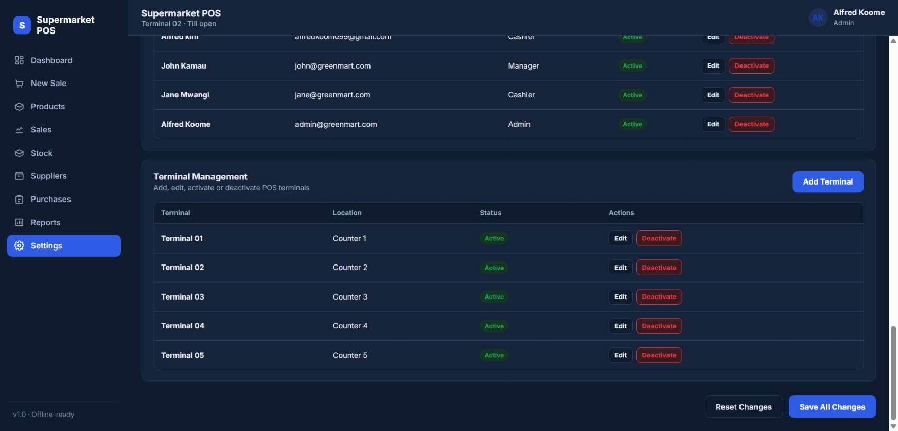


### related technologies

### idle timeout
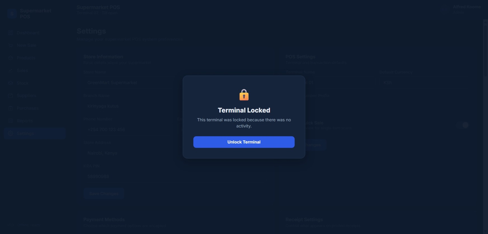

### login page
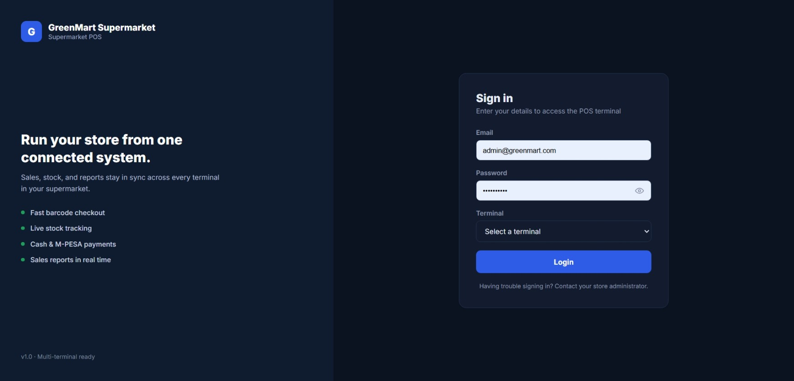

### RBAC
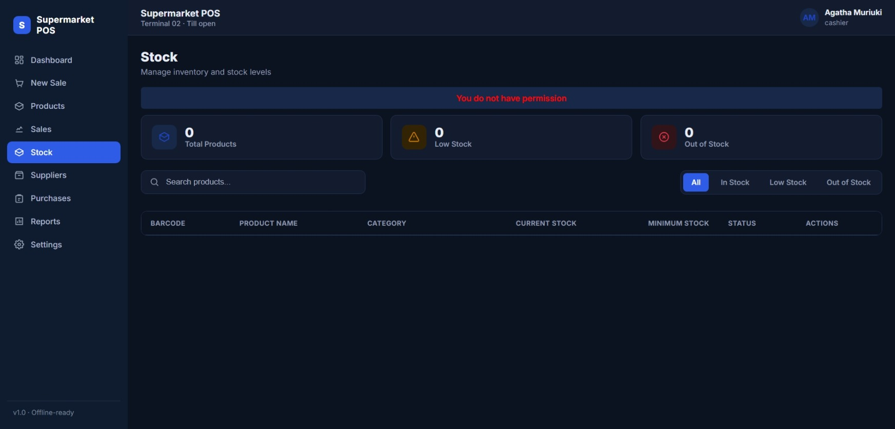


## Technology Stack

| Component               | Technology           |
| ----------------------- | -------------------- |
| Frontend                | HTML5                |
| Styling                 | CSS3                 |
| Frontend Logic          | Vanilla JavaScript   |
| Backend                 | Node.js              |
| Backend Framework       | Express.js           |
| Database                | MySQL                |
| Database Driver         | mysql2               |
| Authentication          | Express Session      |
| Password Security       | bcrypt               |
| Payment Integration     | Safaricom Daraja API |
| Development Environment | Visual Studio Code   |

## System Architecture

The application follows a client-server architecture.

```text
       POS FRONTEND
       HTML / CSS / JS
             |
             |
          HTTP API
             |
             |
       NODE.JS BACKEND
          EXPRESS
             |
             |
        MYSQL DATABASE
             |
             |
       BUSINESS DATA
```

Multiple POS terminals can communicate with the backend and access the centralized database through a local network.

## Installation and Setup

### Prerequisites

Install the following:

- Node.js
- MySQL Server
- Git
- Visual Studio Code (recommended)

### 1. Clone the Repository

```bash
git clone https://github.com/Alfredkoome/supermarket_pos
```

### 2. Navigate to the Project

```bash
cd supermarket_pos
```

### 3. Install Backend Dependencies

```bash
cd backend
npm install
```

### 4. Configure Environment Variables

Create a `.env` file in the backend directory and configure the required database and payment integration credentials.

Do not upload sensitive credentials to GitHub.

### 5. Configure MySQL

Create the database:

```sql
CREATE DATABASE supermarket_pos;
```

Import the project's database structure and required initial data.

### 6. Start the Backend

```bash
npm start
```

The backend runs on the configured local server port (default: 3000).

### 7. Launch the Frontend

Open the frontend entry HTML file using your configured local development server.

Ensure the frontend API configuration points to the correct backend address.

## Offline Operation

The system is designed primarily for local operation.

Core supermarket operations communicate with the local backend and MySQL database without requiring an external hosting service.

**M-PESA integration requires an internet connection** to communicate with Safaricom's Daraja API.

ngrok is used to expose the locally running backend through a secure public tunnel, enabling external services such as Safaricom Daraja API to communicate with the application.

## Project Goals

The main objectives of this project are:

- Simplify supermarket sales operations.
- Improve inventory management.
- Reduce manual record keeping.
- Improve transaction accuracy.
- Centralize business information.
- Support multiple POS terminals.
- Provide reliable business reporting.
- Improve operational efficiency through automation.

## Project Status

The system has implemented its major operational modules, including sales, inventory, product management, purchasing, supplier management, reporting, user authentication and backup functionality.

Development and testing continue as the system evolves.

## Future Improvements

Potential areas for further development include:

- Enhanced receipt printing.
- Advanced business analytics.
- Additional payment integrations.
- Improved deployment and installation procedures.
- Expanded system monitoring.

## Developer

**Alfred Koome**

Computer Science Student
Kirinyaga University

Developed as a practical software engineering project focused on solving real-world supermarket management challenges.

---

*Supermarket POS — Simplifying Retail Operations Through Technology.*
